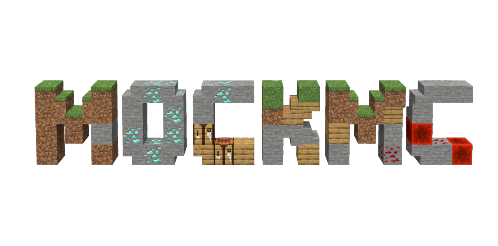

<p align="center">
    <!-- Badges -->
    <a href="https://secondlifegaming.github.io/MockMC/">
        
    </a>
    <a href="https://secondlifegaming.github.io/MockMC/explorer/">
        
    </a>
    <a href="https://github.com/SecondLifeGaming/MockMC/releases">
        
    </a>
    <br />
    <a href="https://github.com/SecondLifeGaming/MockMC/actions/workflows/build.yml">
        
    </a>
    <a href="https://sonarcloud.io/project/issues?resolved=false&types=CODE_SMELL&id=SecondLifeGaming_MockMC">
        
    </a>
    <a href="https://sonarcloud.io/component_measures?id=SecondLifeGaming_MockMC&metric=sqale_rating&view=list">
        
    </a>
    <a href="https://sonarcloud.io/project/issues?resolved=false&types=BUG&id=SecondLifeGaming_MockMC">
        
    </a>
    <!-- Logo -->
    <hr />
        
    <hr />
</p>

MockMC is an automated, type-safe testing framework for the modern Minecraft ecosystem, forked from the excellent [MockBukkit](https://github.com/MockBukkit/MockBukkit) project.

While MockBukkit is built exclusively for the Bukkit/Paper backend with handcrafted in-game simulation, MockMC expands testing across **the entire server and proxy stack — Paper, Folia (regional multithreading), Velocity, and Waterfall** — powered by an automated bytecode generation engine that provides 100% compile-safe method coverage.

---

## 📚 Documentation & Developer Reference

Explore our interactive guides and API compatibility explorer:

- 🌐 **[Developer Documentation Hub](https://secondlifegaming.github.io/MockMC/)**: Comprehensive setup guides, testing recipes, and architecture documentation.
- 🔍 **[Interactive API Explorer](https://secondlifegaming.github.io/MockMC/explorer/)**: Instant version-range diffs (Added, Breaking, Deprecated) across validated Paper and Folia releases (26.2 → 26.3) covering 16,000+ API symbols.
- 🚀 **[Multi-Version Testing Guide](https://secondlifegaming.github.io/MockMC/guides/multi-version-testing)**: How to structure tests across Paper, Folia, Velocity, and Waterfall in a single test suite.
- 🧪 **[Your First MockMC Test](https://secondlifegaming.github.io/MockMC/guides/first-test)**: Step-by-step tutorial on bootstrapping server mocks and testing plugin events.

---

## ⚖️ MockBukkit vs. MockMC: Which Should You Use?

| Feature                    | MockBukkit                                                                            | MockMC                                                                                     |
| :------------------------- | :------------------------------------------------------------------------------------ | :----------------------------------------------------------------------------------------- |
| **Ecosystem Reach**        | **Paper & Bukkit only** (single backend server focus).                                | **Full Platform Stack**: **Paper**, **Folia** (regional threading), **Velocity**, and **Waterfall**. |
| **Primary Goal**           | Deep in-game behavioral simulation (physics, complex event lifecycles, recipe logic). | **Multi-platform test coverage** and rapid adaptation to new APIs with **100% compile safety**. |
| **Folia Support**          | ❌ None (`RegionScheduler`, `AsyncScheduler` unsupported).                           | ✅ **Supported**: Synchronously executes Folia regional schedulers in tests.               |
| **Proxy Testing**          | ❌ None (no Velocity or BungeeCord APIs).                                             | ✅ **Supported**: Full API mirrors for `com.velocitypowered.api` and `net.md_5.bungee`.    |
| **Method Implementation**  | Handcrafted behavior for each method.                                                 | Automated **Smart Stubs** generated directly from server bytecode via JavaPoet.            |
| **New Release Turnaround** | Requires manual coding of new API methods before tests can compile.                   | **Automated Pipeline**: Regenerates the full API surface automatically from upstream JARs. |
| **Unimplemented Methods**  | Often throws `UnimplementedOperationException`.                                       | Safe defaults (`false`, `0`, `Optional.empty()`, empty collections).                       |
| **Behavior Guarantee**     | Simulates vanilla state progression.                                                  | Simulates registered behavior; unmapped methods return safe non-crashing defaults.         |

> [!TIP]
> **Rule of Thumb:**
>
> - **Use MockBukkit if:** You are building exclusively for a single Paper/Bukkit server and need deep simulation of vanilla Minecraft mechanics (e.g. block physics, complex entity AI, vanilla crafting).
> - **Use MockMC if:** 
>   1. You develop **cross-platform plugins** targeting **Velocity, Waterfall/BungeeCord, or Folia** alongside Paper.
>   2. You want your tests to **compile and run cleanly against modern Paper/Folia builds** without failing on unmocked interface methods or platform-specific schedulers.

---

## 🗺️ Version Support Matrix & Pinned Compatibility Contract

MockMC does not dynamically pull arbitrary snapshots; it operates on an **explicitly pinned multi-tier contract**. The latest Paper target serves as the canonical Bukkit and Paper API baseline, while supplementary platform artifacts supply platform-exclusive namespaces:

| Platform      | Pinned Target Build          | Role in MockMC          | Scope                                                            |
| ------------- | ---------------------------- | ----------------------- | ---------------------------------------------------------------- |
| **Paper**     | `paper-26.3-178`             | **Canonical Authority** | Full Bukkit and Paper API (`org.bukkit.*`, `io.papermc.paper.*`) |
| **Folia**     | `folia-26.2-7`               | **Platform Extension**  | Region schedulers (`io.papermc.paper.threadedregions.*`)         |
| **Velocity**  | `velocity-4.2.1-SNAPSHOT-36` | **Proxy Extension**     | Velocity API (`com.velocitypowered.api.*`)                       |
| **Waterfall** | `waterfall-1.21-615`         | **Proxy Extension**     | BungeeCord/Waterfall API (`net.md_5.bungee.*`)                   |

_For complete details on artifact pinning, classloader isolation, and upgrade lifecycles, see [`docs/MULTI_VERSION_ARCHITECTURE.md`](docs/MULTI_VERSION_ARCHITECTURE.md) and [`docs/VERSION_SUPPORT.md`](docs/VERSION_SUPPORT.md)._

---

## ⚙️ How It Works: "Engine First"

MockMC decouples API compilation from manual implementation:

1. **Autonomous Bytecode Remapping**: The [`metaminer`](/metaminer) engine inspects target server JARs (`Paper`, `Folia`, `Velocity`) and remaps them without external build plugins.
2. **Automated API Mirrors**: JavaPoet generates `*BaseMock` interfaces with non-crashing Smart Stubs for every discovered interface method.
3. **Layered Behavior**: Manual implementations focus strictly on stateful behavior (player simulation, custom matchers, inventory state); the generator handles the remaining 95% of boilerplate.

---

## Usage

MockMC is published to Maven Central for frictionless public resolution. Visual tracking releases are also mirrored directly to GitHub Packages.

<details>
<summary><h3>Adding MockMC via Gradle (Kotlin DSL)</h3></summary>

Add the Paper public repository and drop MockMC into your dependencies block:

```kotlin
repositories {
    mavenCentral()
    maven { url = uri("https://repo.papermc.io/repository/maven-public/") }
}

dependencies {
    // Pinned release line
    testImplementation("io.github.secondlifegaming:mockmc:0.0.5")
    testImplementation("io.papermc.paper:paper-api:26.3.build.178-stable")
}
```

</details>

<details>
<summary><h3>Adding MockMC via Maven</h3></summary>

Add the Paper repository mapping and the library dependencies to your plugin’s `pom.xml`:

```xml
<repositories>
    <repository>
        <id>papermc</id>
        <url>https://repo.papermc.io/repository/maven-public/</url>
    </repository>
</repositories>

<dependencies>
    <dependency>
        <groupId>io.github.secondlifegaming</groupId>
        <artifactId>mockmc</artifactId>
        <version>0.0.5</version>
        <scope>test</scope>
    </dependency>

    <dependency>
        <groupId>io.papermc.paper</groupId>
        <artifactId>paper-api</artifactId>
        <version>26.3.build.178-stable</version>
        <scope>test</scope>
    </dependency>
</dependencies>
```
```

</details>

### Quick Start

Initialize the mock server pipeline inside your unit test setup:

```java
private ServerMock server;
private MyPlugin plugin;

@BeforeEach
public void setUp() {
    server = MockMC.mock();
    plugin = MockMC.load(MyPlugin.class);
}

@AfterEach
public void tearDown() {
    MockMC.unmock();
}
```

---

## 🛡️ Smart Stub Defaults & Behavioral Limitations

When an API method does not yet have an explicit behavioral simulation in a manual mock, generated mocks automatically return safe defaults instead of throwing `UnimplementedOperationException`:

| Return Type                             | Default Value                                       |
| :-------------------------------------- | :-------------------------------------------------- |
| **Primitives (`boolean`, `int`, etc.)** | `false`, `0`, etc.                                  |
| **Optionals**                           | `Optional.empty()`                                  |
| **Collections / Lists / Sets**          | Empty, immutable collection                         |
| **Adventure Components**                | `Component.empty()`                                 |
| **Objects / Interfaces**                | `null` (or isolated default mock where appropriate) |

> [!WARNING]
> **Limitations of Safe Defaults:**
> A safe default (such as returning `false`, `0`, or `null`) prevents runtime test crashes when your plugin calls peripheral server methods. However, **it does not simulate active server state progression**. If your test asserts on the downstream side effects of an unmocked method (for example, world physics or mob AI reactions), you must explicitly mock or assert that behavior in your test setup.
>
> See [`docs/GENERATOR_AND_COVERAGE.md`](docs/GENERATOR_AND_COVERAGE.md) for how MockMC accounts for structural API surface versus functional simulation depth.
