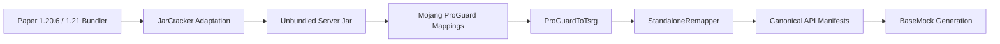

# RFC: Backwards Version Expansion to 1.21 & 1.20.6

- **Status**: Proposed / Draft
- **Branch**: `rfc/version-expansion-1.21`
- **Author**: MockMC Core Architecture Team
- **Target Phase**: Phase 6.x / Phase 7 Transition
- **Related Documents**:
    - [`docs/ARCHITECTURE.md`](ARCHITECTURE.md)
    - [`docs/MULTI_VERSION_ARCHITECTURE.md`](MULTI_VERSION_ARCHITECTURE.md)
    - [`docs/VERSION_SUPPORT.md`](VERSION_SUPPORT.md)
    - [`docs/RFC_MANIFEST_SCHEMA.md`](RFC_MANIFEST_SCHEMA.md)
    - [`docs/RFC_DEVELOPER_WIKI.md`](RFC_DEVELOPER_WIKI.md)
    - [`jars/manifests/versions.json`](../jars/manifests/versions.json)

---

## 1. Executive Summary & Problem Statement

MockMC currently mirrors modern Paper 26.x releases (`26.2` and `26.3`) with Folia `26.2` extensions. While this provides complete coverage for modern production servers, the wider Minecraft plugin ecosystem spans active deployments on Minecraft **1.21.x** and **1.20.6**.

This RFC establishes:

1. **Definitive Version Scope Boundary**: Cutoff strictly established at **Minecraft 1.21.x and 1.20.6** (excluding legacy pre-component 1.18–1.20.4).
2. **Java 25 Execution & Bytecode Target Strategy**: Preserving Java 25 host workflows without workstation downgrades via toolchain isolation and JEP 403 reflection decoupling.
3. **Engine & Metaminer Ingestion**: Extending `JarCracker` and `ProGuardToTsrg` for 1.20.6/1.21 bundler layouts and mappings.
4. **Conditional Component Fallback Architecture**: Introducing resilient component and registry defaults when evaluating across version bounds.

---

## 2. Version Scope & Architectural Boundaries

```
 Modern Component Era (MockMC Supported Range)
-----------------------------------------------------------------------------------------
 [26.3-178] ---> [26.2-134] ---> [26.1.2-74] ---> [1.21.11-132] ---> [1.20.6-151]
  (Canonical)    (Fallback)     (Fallback)       (Fallback)          (Terminal Fallback)

 |<--------------- 26.x Naming Convention -------------->|<-- Minecraft SemVer Epoch -->|
                                                         |
                                       [The Legacy Divide - Deferred]
                                      [1.20.4] ---> [1.19.x] ---> [1.18.x]
```

### 2.1 Pinned Multi-Generation Matrix

With the shift in Paper/Folia release versioning from traditional Minecraft SemVer (`1.20`, `1.21`) to year-based generation milestones (`26.1`, `26.2`, `26.3`), MockMC pins the latest stable patch build for each distinct generation line across both primary and extension platforms:

#### Paper (Primary / Canonical & Historical Fallbacks)

| Release Generation | Pinned Artifact         | Build | Status Tier           | Authority / Purpose                                |
| :----------------- | :---------------------- | :---- | :-------------------- | :------------------------------------------------- |
| **Paper 26.3**     | `paper-26.3-178.jar`    | 178   | **Tier 1: Canonical** | Source of truth for all common Bukkit & Paper APIs |
| **Paper 26.2**     | `paper-26.2-134.jar`    | 134   | **Tier 3: Fallback**  | Historical differential scanning                   |
| **Paper 26.1**     | `paper-26.1.2-74.jar`   | 74    | **Tier 3: Fallback**  | Historical differential scanning (26.1 transition) |
| **Paper 1.21**     | `paper-1.21.11-132.jar` | 132   | **Tier 3: Fallback**  | Terminal 1.21.x API surface                        |
| **Paper 1.20**     | `paper-1.20.6-151.jar`  | 151   | **Tier 3: Fallback**  | Lower bound & Data Component origin baseline       |

#### Folia (Platform Extension & Parity)

| Release Generation | Pinned Artifact        | Build | Status Tier                     | Authority / Purpose                                                              |
| :----------------- | :--------------------- | :---- | :------------------------------ | :------------------------------------------------------------------------------- |
| **Folia 26.3**     | `folia-26.3-3.jar`     | 3     | **Tier 2: Extension (Primary)** | Regional threading parity with Paper 26.3 (`io.papermc.paper.threadedregions.*`) |
| **Folia 26.2**     | `folia-26.2-7.jar`     | 7     | **Tier 2: Extension**           | Historical regional scheduler scanning                                           |
| **Folia 26.1**     | `folia-26.1.2-8.jar`   | 8     | **Tier 2: Extension**           | Historical regional scheduler scanning                                           |
| **Folia 1.21**     | `folia-1.21.11-14.jar` | 14    | **Tier 2: Extension**           | Terminal 1.21.x Folia scheduler extension                                        |
| **Folia 1.20**     | `folia-1.20.6-6.jar`   | 6     | **Tier 2: Extension**           | Baseline Folia scheduler extension                                               |

### 2.2 The Recommended Cutoff ($\mathbf{1.20.6}$)

Minecraft 1.20.5 and 1.20.6 introduced the fundamental **Data Component architecture** (`ItemComponentTypes`, structured item attributes, and component patches), replacing arbitrary serialized NBT on `ItemStack` / `ItemMeta`.

Because MockMC's 26.x item stack and meta mock architecture is built natively upon component stubs and component holders, targeting 1.21.x and 1.20.6 shares a uniform object model:

- Same structural data component pipelines.
- Registry key holders and tag resolution paths remain consistent.
- No legacy NBT conversion layer or dual `ItemMeta` serialization bridge is required.

### 2.3 The Legacy Divide ($\mathbf{1.18}$–$\mathbf{1.20.4}$)

Versions $\le 1.20.4$ rely on pre-component material registries, legacy custom model data integers, and direct NBT compound mutations. Expanding to 1.18–1.20.4 introduces high architectural drag to the `metaminer` engine.

- **Decision**: All versions prior to 1.20.6 are explicitly deferred to a separate, dedicated legacy RFC after the modern component-based range is stabilized and verified.

---

## 3. Java 25 Compatibility & Toolchain Management

MockMC development and CI runners operate on **Java 25**. Expanding to 1.21 (Java 21 bytecode) and 1.20.6 requires zero workstation downgrades, governed by JVM bytecode rules and Gradle isolation.

### 3.1 Bytecode Interoperability

- The Java Virtual Machine guarantees full backwards compatibility: Java 25 natively loads and runs Java 17 and Java 21 bytecode classes without emulation or translation layers.
- Production and testing tasks will configure `jvmToolchain(25)` for host execution while preserving targeted source and target compatibility per module.

### 3.2 Strong Encapsulation & Reflection Under JEP 403

Legacy plugin code, internal mocks, and reflection-driven test utilities can trigger `InaccessibleObjectException` under Java 25's strict strong encapsulation.

- **Mitigation**: Gradle test suites targeting multi-version compatibility will enforce standard JVM module opening flags:
    ```kotlin
    tasks.withType<Test>().configureEach {
        jvmArgs(
            "--add-opens=java.base/java.lang=ALL-UNNAMED",
            "--add-opens=java.base/java.util=ALL-UNNAMED",
            "--add-opens=java.base/java.lang.reflect=ALL-UNNAMED",
            "--add-opens=java.base/java.io=ALL-UNNAMED"
        )
    }
    ```

### 3.3 Gradle Toolchain Isolation & Multi-Release Targets

- Root compilation remains anchored to the primary Java toolchain (`jvmToolchain(25)` or `21` baseline).
- Target compatibility for cross-version verification suites can leverage Gradle JVM test suites and source set isolation without compromising the core engine.

---

## 4. Metaminer & Ingestion Pipeline Adaptation

To ingest and generate smart stubs for Paper 1.21.x and 1.20.6, `metaminer` requires two targeted adaptations:



### 4.1 `JarCracker` Bundler Detection

- `JarCracker.detectMcVersion(File bundlerJar)`:
    - Account for 1.20.6 / 1.21 `META-INF/versions.list` format and bundler packaging layout.
    - Detect Mojang version identifiers (e.g. `1.20.6`, `1.21.1`) and maintain stable cache paths (`patched-paper-1.21.1.jar`).
    - Cache validation (`isValidCache`) must ensure legacy paperclip/bundler extraction executes reliably without re-extracting unchanged artifacts.

### 4.2 `ProGuardToTsrg` Mapping Profile Ingestion

- Ingest 1.20.6 and 1.21 Mojang ProGuard mappings.
- Ensure regular expressions handling field signatures, synthetic member mappings, and method line mappings parse cleanly without dropping package-private or inherited interface stubs.

---

## 5. Component Fallback & Registry Tolerances

When consumer code or mock tests execute across 1.20.6, 1.21, and 26.x, subtle additions to `ItemComponentTypes` and registry keys occur (e.g. newly added weapon components, banner patterns, or food properties in later point releases).

### 5.1 Defensive Fallback Policy

1. **Dynamic / Soft Lookup for Components**:
    - `ItemComponentFactory` must verify whether an `ItemComponentType` key exists in the active runtime classpath before attempting strict registration.
    - Missing or unknown components in earlier minor builds gracefully return `Optional.empty()` or no-op defaults rather than throwing fatal class-initialization or registry errors.
2. **Registry Fallbacks**:
    - Mocks querying registries for keys introduced in 26.x when running under a 1.20.6/1.21 context must return empty lookups instead of crashing with `NoSuchElementException`.

---

## 6. Execution Roadmap

| Step        | Milestone                            | Deliverable                                                                                                                            |
| :---------- | :----------------------------------- | :------------------------------------------------------------------------------------------------------------------------------------- |
| **Phase 1** | **Manifest & Artifact Pinning**      | Register Paper 1.21.1 and 1.20.6 builds into `jars/manifests/versions.json` with SHA-256 hashes.                                       |
| **Phase 2** | **JarCracker & ProGuard Adaptation** | Verify unbundling and TSRG conversion against 1.20.6 and 1.21 jars; add unit tests in `metaminer`.                                     |
| **Phase 3** | **Toolchain & JVM Arguments**        | Configure `--add-opens` flags and compile compatibility in `build.gradle.kts`.                                                         |
| **Phase 4** | **Component Fallback Layer**         | Implement safe defaults in component factories for cross-version testing.                                                              |
| **Phase 5** | **Full Pipeline Verification**       | Run `./gradlew downloadJars && ./gradlew :metaminer:runGenerator && ./gradlew spotlessApply && ./gradlew compileJava compileTestJava`. |

---

## 7. Reference Material

- [History of Minecraft: Java Edition — Every Update Up To 1.21](https://www.youtube.com/watch?v=XHSsP3KO7-I)
- [JEP 403: Strongly Encapsulate JDK Internals](https://openjdk.org/jeps/403)
- PaperMC Fill-Data API & Artifact Specifications
