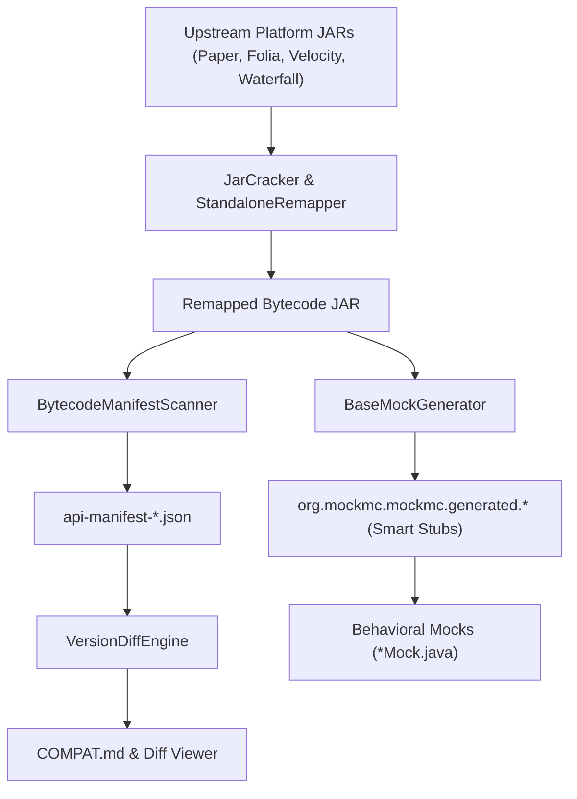

# MetaMiner & Engine-First Architecture

MockMC operates under an **"Engine-First" mission**: achieving 100% automated API mirrors using bytecode discovery and dynamic generation in `metaminer`.

## Core Architectural Invariants

1. **Zero Manual Stubs**: Manual mock classes focus strictly on stateful behavior, not API compliance boilerplate.
2. **Deterministic Smart Stubs**: All interface methods are generated automatically with safe defaults (empty collections, non-null optionals, fluent builder returns).
3. **Canonical Manifest Model**: Bytecode metadata is parsed into strongly typed `ApiManifest` structures with full class disposition tracking (`ANALYZED`, `JUSTIFIED_EXCLUSION`, `FAILED`).
4. **Decoupled Overlays**: Upstream bytecode facts are completely independent of MockMC implementation status and unit test results (`mockmc-overlay-v1.json`).
5. **Pairwise Diff Engine (`VersionDiffEngine`)**: Detects binary breaking changes, source incompatibilities, and migrations by tracking JVM descriptors as atomic identity.

